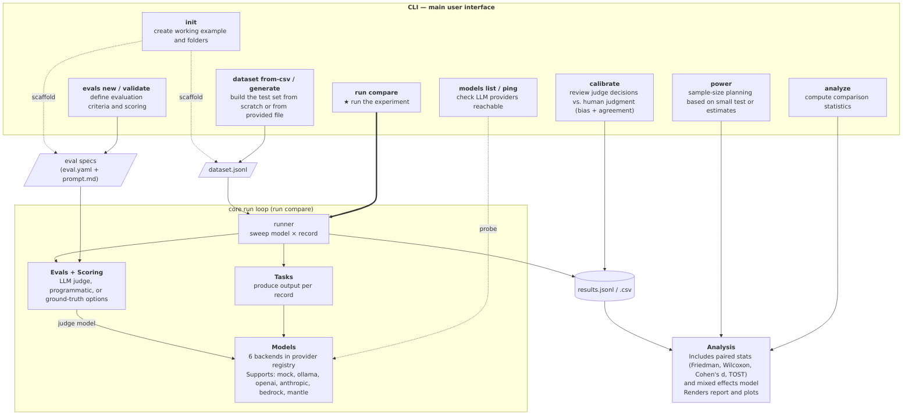
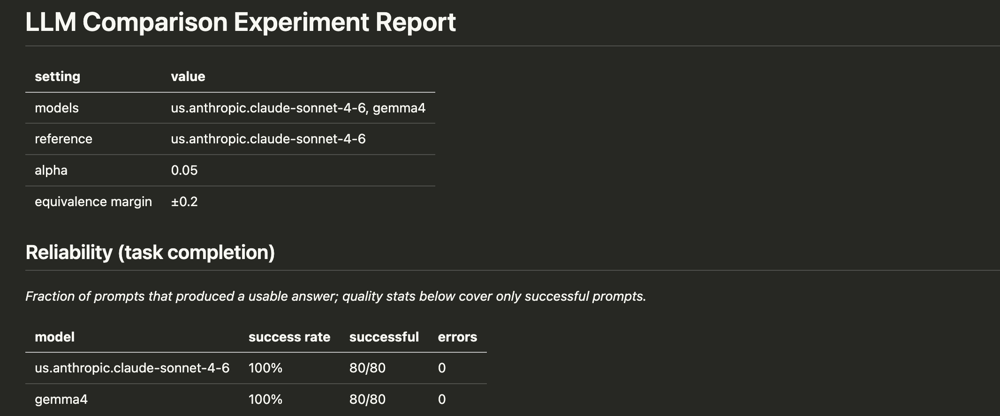
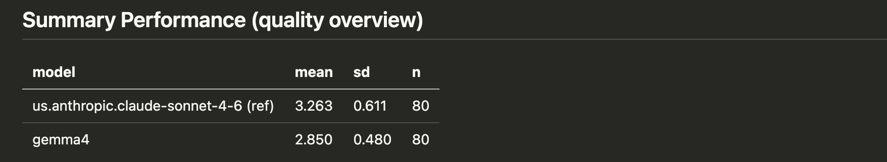
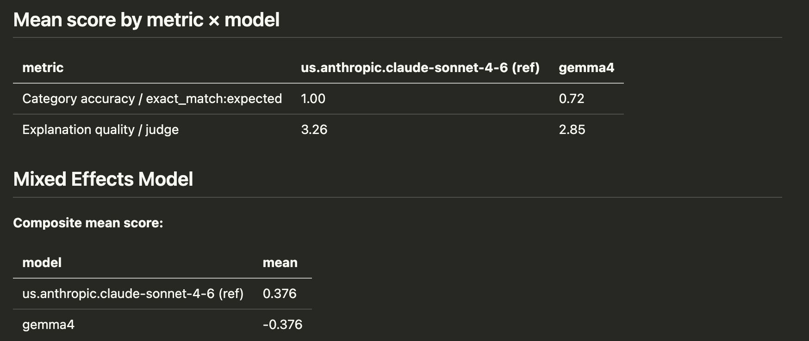
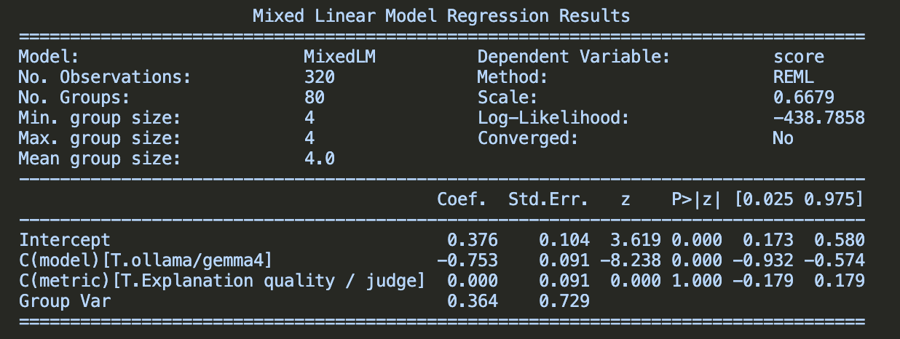
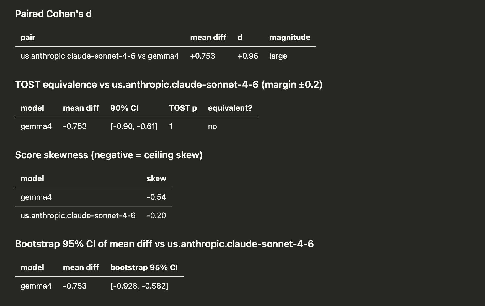
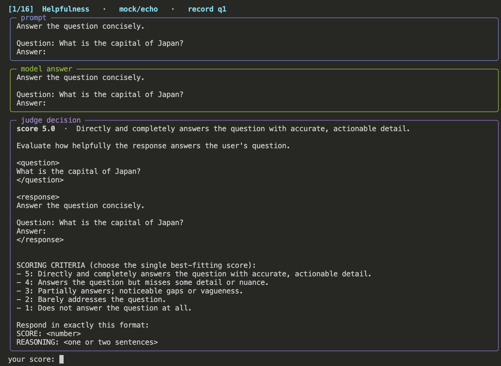

# Find the LLM You Need

[](https://pypi.org/project/llm-workbench/)
[](https://www.python.org/downloads/)
[](https://github.com/Nebulock-Inc/llm-workbench/blob/main/LICENSE)

**[Quickstart](#quickstart-scaffold-a-starter-and-run-it)** • **[Install](#install--setup)** • **[Define a task](#defining-your-task)** • **[Run a comparison](#running-the-experiment)** • **[Analyze results](#result-analysis)** • **[Examples](examples/)**

## Introduction

Teams often choose LLMs by vibes or minimal spot checking. Unfortunately, this process opens us up to missing real gaps in model performance or regressions, even when we're using expensive frontier models. Instead, we can apply statistical techniques to figure out which model is truly the best quality for our use cases. 

The `llm-workbench` Python library guides data scientists and machine learning practitioners through the process of statistically evaluating multiple LLMs for performance on custom tasks, including agentic tasks. It's lightweight and flexible, but guides you on how to structure your work to get reliable and trustworthy results. 

The toolkit supports the following tasks:

* [Defining your task](#defining-your-task) (what your LLM needs to do)
* [Creating](#eval-creation) and [calibrating](#calibrating-the-judge) evals
* Running a small [pilot study](#pilot-study)
* Running [power analysis](#power-analysis---how-many-prompts) to know how many prompts you need
* Creating a [test set of prompts](#prompt-test-set-creation)
* [Running the experiment](#running-the-experiment), collecting prompt/response pairs using LLMs from Anthropic, OpenAI, Ollama, or AWS Bedrock (including Bedrock Mantle)
* [Analyzing the results](#result-analysis), selecting the best model for your use case


## Install & Setup

Requires Python 3.12+.

Install it into your own project — the whole toolkit is one package with a single CLI:

```bash
uv add "llm-workbench[analysis]"        # or: pip install "llm-workbench[analysis]"
```

Extras keep the base install light; add the ones you need:

| Install | Adds | You need it if… |
|---|---|---|
| `llm-workbench` | Ollama + AWS Bedrock clients | you only use local Ollama or Bedrock |
| `llm-workbench[openai]` | OpenAI SDK | you use `openai/` **or** `bedrock-mantle/` model ids |
| `llm-workbench[anthropic]` | native Anthropic SDK | you use the `anthropic/` client |
| `llm-workbench[analysis]` | pandas / scipy / statsmodels / matplotlib | you run `power` or `analyze` — **most users want this** |

Combine them as needed, e.g. `uv add "llm-workbench[analysis,anthropic]"`.

Using conda instead of uv? It works, with a few project-specific caveats — see [Installing with conda](docs/installing-with-conda.md).

Everything is driven by one CLI, `llm-workbench` (verify the install):

```bash
llm-workbench --help
```

The workflow follows the sections below: **define your task → create evals → run a small pilot → size the study with power analysis → build the full test set → run the comparison → analyze the results.**



Read on to learn how to use it for all these steps.


## Quickstart (scaffold a starter and run it)

`llm-workbench init` writes a tiny, self-contained example into your current directory — a
general-knowledge Q&A dataset (`dataset.jsonl`), a prompt template (`prompt.txt`), and a
judge eval (`evals_kit/example-helpfulness/`). These are yours to keep and edit, so you see
the whole loop before wiring up your own task and data.

```bash
llm-workbench init          # scaffolds prompt.txt, dataset.jsonl, evals_kit/example-helpfulness/
```

**1. Smoke test with zero credentials.** The `mock/echo` provider just echoes the prompt,
so this needs no API keys — it proves the pipeline runs end to end (no judge, so no scores):

```bash
llm-workbench run compare \
    --prompt-template prompt.txt --dataset dataset.jsonl \
    --model mock/echo --eval example-helpfulness --out-dir runs/example
```

**2. A real local comparison with Ollama.** Pull a couple of local models
(`ollama pull llama3.1 && ollama pull mistral`), then compare them and use one as the judge
to actually score answers:

```bash
llm-workbench run compare \
    --prompt-template prompt.txt --dataset dataset.jsonl \
    --model ollama/llama3.1 --model ollama/mistral \
    --eval example-helpfulness --judge-model ollama/llama3.1 --out-dir runs/example
llm-workbench analyze runs/example --reference ollama/llama3.1   # needs the `analysis` extra
```

From here, replace the starter with your own: write your dataset (or build one with
`llm-workbench dataset`), create an eval with `llm-workbench evals new`, and — if your task needs more
than filling a template — a custom `--task`. The repo's
[`examples/`](examples/) has custom-task templates: [`examples/my_task.py`](examples/my_task.py)
(minimal) and [`examples/org_scoped_task.py`](examples/org_scoped_task.py) (injects per-record
context and exposes derived values to the eval via `aux`).

A built-in task, `--task llm_workbench.tasks:ReplayTask`, scores an answer already stored in the
record instead of calling the model under test — for calibrating the judges, regression-testing
a rubric or judge-model change, or re-scoring a past run. See
[Replaying stored outputs](docs/complex-prompts-and-custom-tasks.md#replaying-stored-outputs-judge-calibration--re-scoring).

## Guided workflow with Claude Code skills

If you use [Claude Code](https://claude.com/claude-code), this toolkit ships a set of skills
that guide you through the whole workflow, including setup, defining a task, creating and calibrating
evals, a pilot, power analysis, the full run, and the analysis. They drive the CLI *and*
explain how to read the results, so you can lean on them instead of the manual steps below.
Open your project in Claude Code and ask something like *"which model should I use for my
task?"*.

Get them one of two ways:

- **Into your project (recommended)** — scaffold them alongside the starter files:

  ```bash
  llm-workbench init --with-skills
  ```

  This writes them to `.claude/skills/`, where Claude Code loads them automatically when you
  open the project. Re-run with `--force` to refresh them after upgrading the package.

- **As a plugin, shared across all your projects** — install from the Claude Code plugin
  marketplace:

  ```
  /plugin marketplace add Nebulock-Inc/llm-workbench
  /plugin install llm-workbench
  ```

The rest of this README is the manual walkthrough the skills follow.

## Defining Your Task

A **task** is the thing you're testing: it takes one record from your dataset, does whatever your LLM needs to do with it, and returns the answer that your evals will score. Everything downstream — the prompts you write, the evals you design, the models you compare — is in service of measuring how well different models perform *this task*. So it's the first thing to pin down, even though the code for it can be as little as one file (or none).

There are two ways to define a task, and most projects only ever need the first.

### The default task: just a prompt template (no code)

If your task is "fill each input into a prompt and ask the model" — the common one-prompt-per-row case — you don't write any code. You write a **prompt template**: a plain text file with `{placeholders}` that get filled from each dataset record's fields. Pass it with `--prompt-template`.

`my_prompt.txt`:
```
You are a helpful security analyst. Answer the question using clear, specific language.

Question: {input}
```

`{input}` is filled from the `input` field of each record in your dataset (see [Prompt Test Set Creation](#prompt-test-set-creation)). Any other field on the record can be a placeholder too — `{org_name}`, `{context}`, etc. — so **multi-variable prompts also need no code**; just add matching fields to your JSONL. (List/dict fields are rendered as readable JSON.) That's the whole task: `run compare --prompt-template my_prompt.txt ...` fills the template, calls each model, and hands the answer to your evals.

### A custom task: when producing the input takes extra steps

Write a **custom task** (a small Python class) only when getting to the answer needs steps *beyond* filling one template — resolving identifiers, injecting tenant/org scoping computed from an id, retrieving context, or a multi-call *generate → run → summarize* pipeline. A task is any class with a `name` and a `run(record, client) -> TaskOutput` method, where `client` is the model under test:

```python
# my_task.py
from llm_workbench.object_types import GenerationRequest
from llm_workbench.tasks.base import TaskOutput

class MyTask:
    name = "my-task"

    def run(self, record, client):
        # 1. do any prep: resolve ids, fetch context, build the prompt from record fields
        prompt = f"Assisting {record['org_name']}.\n\nQuestion: {record['input']}"
        # 2. call the model under test as many times as your workflow needs
        resp = client.generate(GenerationRequest(prompt=prompt, max_tokens=512))
        # 3. return the answer; expose any derived values to eval prompts via `aux`
        return TaskOutput(output=resp.text, prompt=prompt, response=resp,
                          aux={"org_name": record["org_name"]})
```

Point `run compare` at it with `--task my_task:MyTask` (the module just needs to be importable from your working directory — `--task` and `--prompt-template` are mutually exclusive). The `aux` dict is how a task surfaces derived values — retrieved context, generated queries, a resolved org — so your eval rubric prompts can reference them as `{placeholders}` exactly like `{input}` and `{output}`.

Two runnable examples ship in the repo: [`examples/my_task.py`](examples/my_task.py) (minimal) and [`examples/org_scoped_task.py`](examples/org_scoped_task.py) (injects scoping and exposes `aux`). For the full contract — what `run` receives, everything `TaskOutput` can carry, how `aux` reaches your evals, and multi-step pipelines — see [Complex Prompts and Custom Tasks](docs/complex-prompts-and-custom-tasks.md). A built-in `ReplayTask` scores a pre-existing answer instead of calling the model under test (the judge model still runs), for judge calibration and re-scoring (see the [Quickstart](#quickstart-scaffold-a-starter-and-run-it) note).

## Eval Creation

An *eval* is a folder (`eval.yaml` + `prompt.md`) describing how to score a model's output — a scoring **rubric** (an LLM judge picks one level) and/or deterministic **checks**. Evals live in `evals_kit/` by default.

Create one with the guided wizard — it walks you through the rubric and the judge prompt:

```bash
llm-workbench evals new
```

It asks for a name, description, a rubric (a 1-5 or binary preset you can edit, or a fully custom scale), which `{variables}` the judge reads (usually `input` = the question and `output` = the model's answer), and any programmatic checks. It previews the files and validates before saving. To skip the prompts (e.g. in CI):

```bash
llm-workbench evals new answer-quality --labels 1-5 --yes
```

Manage existing evals:

```bash
llm-workbench evals list                 # table of evals, their scales, and variables
llm-workbench evals validate             # check every eval in evals_kit/ parses
```

**Scoring options** an eval can use:
- **LLM judge** — a rubric of `label: score` pairs; a judge model reads the prompt and picks one level.
- **Programmatic checks** — deterministic, no model needed: `exact_match`, `contains`, `regex`, `json_schema`, `numeric_tolerance`.
- **Operational** — `latency` thresholds read from each call's metadata.

For the full `eval.yaml` key list, how the judge prompt is filled and scored, and each scorer's parameters, see the [Eval Reference](docs/eval-reference.md). For guidance on *what* evals to create and how to design good rubrics, see the FAQ.

## Pilot Study

In order to know how large your full experiment needs to be for statistical significance, you'll need to run a small pilot test first.

The number of prompts you need depends on how *different* your candidate models actually are on your task — a gap you can't know in advance. If they're far apart, a handful of prompts settles it; if they're close, you need many more to tell them apart reliably. A pilot measures that gap in miniature, and the power analysis (next section) turns it into a concrete target sample size.

**1. Make a small, representative prompt set.** Hand-write or generate ~10–20 prompts that resemble production traffic (see [Prompt Test Set Creation](#prompt-test-set-creation) for the JSONL format and the `dataset` builders). It doesn't need to be large — only representative enough to estimate the models' relative quality.

**2. Run the comparison on it**, using the same models, evals, and judge you intend to use for the full study, so the measured effect is realistic:

```bash
llm-workbench run compare \
    --prompt-template my_prompt.txt \
    --dataset pilot.jsonl \
    --model ollama/llama3.1 --model anthropic/claude-sonnet-4-5 \
    --eval answer-quality \
    --judge-model bedrock/anthropic.claude-3-5-sonnet-20240620-v1:0 \
    --out-dir runs/pilot
```

This writes `runs/pilot/results.jsonl`, which is the input to `llm-workbench power --from-run` below. (Runs resume, so you can also grow the pilot later by re-running with more prompts — new prompts are appended, already-scored ones are skipped.)

A pilot is worth the cost because it uses *your* task and *your* evals; a sample size guessed from a generic effect size can be off by an order of magnitude. If you genuinely can't run one, the power tool also accepts an assumed effect size directly (see below).

## Power Analysis - How Many Prompts?

Because every prompt is run on every model, this is a **paired (repeated-measures)** design: the unit is the per-prompt difference between models. `llm-workbench power` turns a difference of a given size (effect size `dz` = mean difference / SD of differences) into the number of prompts needed to detect it reliably. Needs the `analysis` extra.

**From your pilot run** (recommended) — size the full study from the effects you actually observed:

```bash
llm-workbench power --from-run runs/pilot --reference ollama/llama3.1
```

This reports, per model vs. the reference, the observed effect, the power your pilot already achieved, and the prompts needed to reach your target power — plus a recommended N for the *smallest* (hardest to detect) effect, since that gap sets the sample size for the whole study. Tune with `--alpha` (default 0.05), `--power` (default 0.8), and `--alternative`.

**Without a pilot** — if you can only assume an effect size, size it directly:

```bash
llm-workbench power --effect-size 0.5              # -> N prompts at alpha=0.05, power=0.8
llm-workbench power --mean-diff 0.4 --sd-diff 0.8  # dz = 0.4 / 0.8 = 0.5, so same N
```

> Sample sizes use the paired t-test; the Wilcoxon test used in `analyze` is ~95% as efficient, so add a small margin if you rely on it.

## Prompt Test Set Creation

Your test set is a **JSONL** file — one JSON object per line. `input` is the standard field the default task fills into your prompt template; add `expected` (used by checks like `exact_match`) and any other fields your task needs. An `id` gives each record a stable identity (used for resume); if omitted, one is generated.

```json
{"id": "q1", "input": "What hunts cover LaunchAgent persistence?", "expected": "..."}
{"id": "q2", "input": "Summarize the last 24h of failed logins for acme-corp."}
```

Author it by hand, or build it:

**From a spreadsheet** (every column becomes a field):

```bash
llm-workbench dataset from-csv prompts.csv -o test_set.jsonl --id-col qid
```

**Generated by an LLM** (a starter set to review and edit):

```bash
llm-workbench dataset generate --model anthropic/claude-sonnet-4-5 \
    --instructions "security-analyst questions about threat hunts and detections" \
    -n 30 --with-expected -o test_set.jsonl
```

## Running the Experiment

Point `run compare` at your dataset, list the candidate models, and choose the eval(s) to score with. Supply `--judge-model` to enable LLM-judge scoring.

```bash
llm-workbench run compare \
    --prompt-template my_prompt.txt \
    --dataset test_set.jsonl \
    --model ollama/llama3.1 --model openai/gpt-4o-mini --model anthropic/claude-sonnet-4-5 \
    --eval answer-quality \
    --judge-model bedrock/anthropic.claude-3-5-sonnet-20240620-v1:0 \
    --out-dir runs/experiment-1
```

`--prompt-template` is a file containing `{input}` (and any other dataset fields) for the default one-prompt-per-row task. Results stream to `runs/experiment-1/results.jsonl` (crash-safe) and flatten to `results.csv`; re-running resumes where it left off (`--no-resume` to disable). Use `--limit N` for a quick pilot.

### `run compare` options

| Option | Required | Default | What it does |
|---|---|---|---|
| `--dataset FILE` | **yes** | — | JSONL test set; one record per line. `input` is filled into the prompt template; other fields are available to custom tasks and eval `{variables}`. |
| `--task module:Class` | one of `--task`/`--prompt-template` | — | Custom task (`run(record, client) -> TaskOutput`) for multi-step pipelines, scoping, or retrieval. Imported from the current directory (e.g. `examples.my_task:MyTask`). See [Complex Prompts and Custom Tasks](docs/complex-prompts-and-custom-tasks.md). |
| `--prompt-template FILE` | one of `--task`/`--prompt-template` | — | Template file for the default one-prompt-per-row task; contains `{input}` and any other dataset fields. Mutually exclusive with `--task`. |
| `--model provider/id` | **yes** (≥1) | — | A candidate model to test. Repeat the flag for each model (`--model a --model b`). See [Connecting Your LLMs](#connecting-your-llms) for id formats. |
| `--models a,b,c` | — | — | Comma-separated model ids, as an alternative or supplement to repeated `--model`. |
| `--eval NAME` | — | all evals in `--eval-dir` | An eval to score with: a folder name under `--eval-dir`, or a path to an eval directory. Repeatable. Omit to run every eval found in `--eval-dir`. |
| `--eval-dir DIR` | — | `evals_kit` | Directory searched for evals (each is a subfolder with `eval.yaml` + `prompt.md`). |
| `--judge-model provider/id` | — | none | Enables LLM-judge scoring for evals that have a rubric. Without it, rubric evals are skipped (a warning is printed); programmatic checks still run. |
| `--out-dir DIR` | — | `runs/<timestamp>` | Where `results.jsonl` / `results.csv` are written. Reuse a directory to resume or grow a run. |
| `--resume` / `--no-resume` | — | `--resume` | Skip `(model, record)` pairs already in the run's `results.jsonl`. `--no-resume` re-runs everything (appends, so prefer a fresh `--out-dir`). |
| `--limit N` | — | all records | Only the first N records — handy for a smoke test before a full sweep. |

Notes:
- Provide exactly one of `--task` or `--prompt-template`, and at least one `--model`.
- The sweep is **model × record**; every model answers every prompt and each eval scores each pair, which is what makes the [result analysis](#result-analysis) a paired design.
- Resume keys on the record's `id` field (or a generated hash if absent) — give records stable `id`s so resume and analysis line up across runs.

**Prompts with several inputs, org/tenant scoping, retrieval, or a multi-step pipeline?** Multi-variable templates work out of the box, and anything needing extra steps is a custom `--task` — see [Complex Prompts and Custom Tasks](docs/complex-prompts-and-custom-tasks.md).

### Connecting Your LLMs

Every model is referenced by a single id string, `provider/model`. The prefix selects the client:

| Prefix | Client | Example id | Needs extra |
|---|---|---|---|
| `ollama/` | local Ollama | `ollama/llama3.1` | — |
| `openai/` | any OpenAI-compatible endpoint (OpenAI, OpenRouter, Together, vLLM, LM Studio, Azure) | `openai/gpt-4o-mini` | `openai` |
| `anthropic/` | native Anthropic API | `anthropic/claude-sonnet-4-5` | `anthropic` |
| `bedrock/` | AWS Bedrock (Claude / Llama / Mistral) | `bedrock/anthropic.claude-3-5-sonnet-20240620-v1:0` | — |
| `bedrock-mantle/` | Bedrock Mantle OpenAI-Responses (e.g. Gemma) | `bedrock-mantle/google.gemma-4-31b` | `openai` |

**Per-provider request-field support.** A `GenerationRequest` carries `system`, `temperature`, and `stop`; `max_tokens` is honored everywhere. Most providers honor all three, with one exception:

| Prefix | `system` | `temperature` | `stop` |
|---|---|---|---|
| `ollama/` | ✅ | ✅ | ✅ |
| `openai/` | ✅ | ✅ | ✅ |
| `anthropic/` | ✅ | ✅ | ✅ |
| `bedrock/` (Claude / Llama / Mistral) | ✅ | ✅ | ✅ |
| `bedrock-mantle/` | ✅ (→ `instructions`) | ✅ | ❌ — the OpenAI-Responses API has no stop-sequence parameter |

Setting `stop` on a `bedrock-mantle/` model has no effect and emits a warning. (`mock/` is a test stub that echoes the prompt and ignores generation parameters.)

Credentials and endpoints come from the environment (a local `.env` is loaded automatically):

- **Ollama**: `OLLAMA_BASE_URL` (default `http://localhost:11434`), `OLLAMA_THINK=false` to disable reasoning-model thinking, `OLLAMA_KEEP_ALIVE`.
- **OpenAI-compatible**: `OPENAI_API_KEY`, and `OPENAI_BASE_URL` to point at a non-OpenAI endpoint.
- **Anthropic**: `ANTHROPIC_API_KEY`.
- **Bedrock / Mantle**: `AWS_PROFILE`, `AWS_REGION` (Mantle is SigV4-signed with your profile — no separate key).

Check providers and test connectivity:

```bash
llm-workbench models list                 # registered providers + example ids
llm-workbench models ping ollama/llama3.1  # one short call, prints latency/result
```

#### Running local models (memory)

`run compare` calls one model at a time, so there is no limit on how many models you compare — with API-backed models (Anthropic, OpenAI, Bedrock) the inference is remote and puts no load on your machine.

The one thing to watch is **local models served through Ollama**. Ollama keeps recently-used models loaded in memory, and because each candidate's answer is scored by the judge right after it is produced, a local candidate and a **local judge** end up resident at the same time. A couple of models together is usually fine; the trouble comes from stacking several large local models — on a memory-constrained machine that can exhaust RAM/VRAM and, on Apple Silicon (where GPU memory is shared with the system), even crash the OS.

If your candidates and judge are all local and memory is tight:

- Use an **API model as the judge** (e.g. `--judge-model anthropic/claude-sonnet-4-5`) so only one heavy model is ever loaded — the least fragile option, and often a better grader.
- Or cap Ollama's residency: `OLLAMA_MAX_LOADED_MODELS=1` and `OLLAMA_KEEP_ALIVE=0` (llm-workbench passes the latter through). This unloads models promptly at the cost of reloading between calls, so runs are slower but stay within memory.
- Smoke-test with `--limit 2` before a full sweep, and add models incrementally — resume fills in the rest without redoing completed work.

### Understanding the Output

Each run directory (`--out-dir`) holds two data files plus, after `analyze`, the analysis artifacts.

**`results.jsonl`** — the source of truth, appended crash-safe as the run proceeds: one JSON object per `(model, record)`. Fields:

| Field | Meaning |
|---|---|
| `model_id`, `record_id` | which model, which dataset record (`record_id` is the record's `id`, or a generated hash) |
| `input` | the full dataset record (all its fields) |
| `output` | the model's answer that the evals scored |
| `prompt` | the prompt actually sent (for debugging) |
| `latency_s`, `usage` | timing / token metadata from the model call |
| `error` | **task-level** error — the row produced no usable output (model failure or a custom task that raised); `null` on success |
| `scores` | list of per-scorer results: `eval`, `scorer`, `score`, `label`, `passed`, `reasoning`, `error` |
| `timestamp` | when the row was written |

**`results.csv`** — `results.jsonl` flattened to one row per `(model, record, scorer)` for spreadsheets/pandas:

| Column | Meaning |
|---|---|
| `model_id`, `record_id` | as above |
| `eval`, `scorer` | which eval and which scorer produced this row |
| `score` | the numeric score (rubric level, `1.0`/`0.0` for a check, or the measured latency) |
| `label` | the rubric label the judge chose (judge evals only) |
| `passed` | pass/fail — set by programmatic checks and operational thresholds; **blank for judge rubrics** (they report a graded score, not pass/fail) |
| `latency_s` | per-call metadata |
| `score_error` | one scorer failed while others may have succeeded (e.g. judge couldn't be reached) |

The CSV covers only tasks that produced a usable output — task-level failures are dropped here (find them in `results.jsonl`'s `error` field and the end-of-run reliability table). `score_error` surfaces the remaining failure mode: the output exists but a specific scorer failed.

**End-of-run tables** printed to the console:
- **Comparison summary** — per `(model, eval, scorer)`: `n`, mean score, pass rate, error count. Pass rate is shown only for scorers that emit pass/fail; judge rubrics show a mean score with a blank pass rate.
- **Per-model reliability** — per model: number of runs, task errors, mean latency.

**Resume** keys on `(model_id, record_id)` present in `results.jsonl` — including rows that errored. So a re-run with `--resume` (the default) skips already-recorded rows, errors included; to retry failures, fix the cause and either start a fresh `--out-dir` or delete the run directory. Give records stable `id`s so resume lines up across runs.

### Result Analysis

`llm-workbench analyze` runs the statistics appropriate to your data and design (paired on prompt). Needs the `analysis` extra.

```bash
llm-workbench analyze runs/experiment-1 --reference anthropic/claude-sonnet-4-5
```




It first reports **reliability** — each model's task-completion rate (fraction of prompts that produced a usable answer, computed from every recorded row including failures). This matters because the quality stats below are complete-case: they only cover prompts a model actually answered, so a model that fails often can still post strong quality scores. Read reliability and quality together.



It then shows an overall means table per model and a mean-score table for each individual metric. 



The full statistical battery runs on a single **quality composite** (the aggregate across quality metrics) — one family of tests on the aggregate, rather than per-metric, to keep the multiple-comparisons story clean. If you want to drill into a single metric, filter with `--eval` / `--scorer` and re-run. On the composite it reports where appropriate:

- **Nonparametric**: Friedman test + Kendall's W (omnibus across ≥3 models), with Holm-corrected pairwise Wilcoxon signed-rank post-hocs.
- **Mixed-effects model**: `score ~ model` with a random intercept per prompt — each model's difference from the reference, with significance. (Graded data only; skipped for binary pass/fail.)
- **Paired Cohen's d**: practical effect-size magnitude for each model pair.
- **TOST equivalence**: whether two models are *statistically the same* within a margin (`--margin`) — something significance tests can't tell you.








It prints rich tables with plain-language interpretation and writes `analysis.json`, `analysis.md`, and comparison plots (`--out-dir`, default: alongside RESULTS; `--no-plots` to skip the figures).


Options:

| Flag | Default | Meaning |
|---|---|---|
| `--reference <model_id>` | first model | Baseline for the mixed model / TOST — every other model's difference is measured against it. |
| `--eval <name>` | all | Restrict to these eval names (repeatable). |
| `--scorer <name>` | all | Restrict to these scorer names (repeatable). |
| `--exclude-metric <name>` | none | Keep a metric out of the aggregate/composite (by eval name or `<eval> / <scorer>` label) while still showing it in the per-metric mean table. Repeatable; use for metrics on a different scale. |
| `--alpha <float>` | `0.05` | Significance level. |
| `--margin <float>` | `0.2` | TOST equivalence margin, in score points. |
| `--out-dir <path>` | alongside RESULTS | Where to write `analysis.json`/`.md` and plots. |
| `--plots` / `--no-plots` | `--plots` | Generate matplotlib figures (needs the `analysis` extra). |
| `--verbose` / `--simple` | `--simple` | Full stats (per-metric mean tables, effect sizes, complete mixed-model summary) vs. headline composite results only. |


## Calibrating the Judge

Before you trust the LLM judge's scores, check that they match your own. `llm-workbench calibrate` walks the judge's scored decisions from a run, shows you each input, the model's answer (including aux fields), and the judge's score + reasoning, and records your own score on the same rubric:

```bash
llm-workbench calibrate runs/experiment-1
```



It's resumable (already-reviewed decisions are skipped unless `--re-review`) and saves your scores to `<run>/review.jsonl`. At the end — or any time with `--stats` — it reports judge-vs-human **calibration** per eval: **bias** (mean judge − mean human; positive means the judge scores higher than you), plus exact- and within-1-agreement rates. A large bias or low agreement is a signal to revise the rubric or judge prompt before drawing conclusions from a run.

The same table is written to disk as `calibration.json` and `calibration.md` (next to the review file, or `--out-dir`; `--no-report` to skip) so you can commit it alongside a run or drop it into a report. Restrict what you review with `--eval`, `--model`, and `--scorer` (all repeatable). A custom `--task` may expose a `review_context()` hook to show live, non-persisted context (e.g. re-running a query to display its results) while you score.

Options:

| Flag | Default | Meaning |
|---|---|---|
| `--eval <name>` | all | Restrict to these eval names (repeatable). |
| `--model <id>` | all | Restrict to these model ids (repeatable). |
| `--scorer <name>` | `judge` | Which scorer's decisions to review (repeatable). |
| `--task <module:Class>` | none | Task whose optional `review_context()` supplies live, non-persisted context per decision. |
| `--review-file <path>` | `<run>/review.jsonl` | Where your scores are stored. |
| `--re-review` | off | Include decisions already reviewed (default skips them). |
| `--stats` | off | Just print calibration stats; no interactive review. |
| `--out-dir <path>` | next to review file | Where to write `calibration.json`/`.md`. |
| `--report` / `--no-report` | `--report` | Write the calibration report files alongside the console table. |


## FAQ
* How do I decide what evals to create, and how to design the rubrics?  
A: Check out my other project, Customizing LLM Evaluations: https://github.com/skirmer/customizing-llm-evals

## Author
Created by Stephanie Kirmer © 2026  
stephanie@nebulock.io


